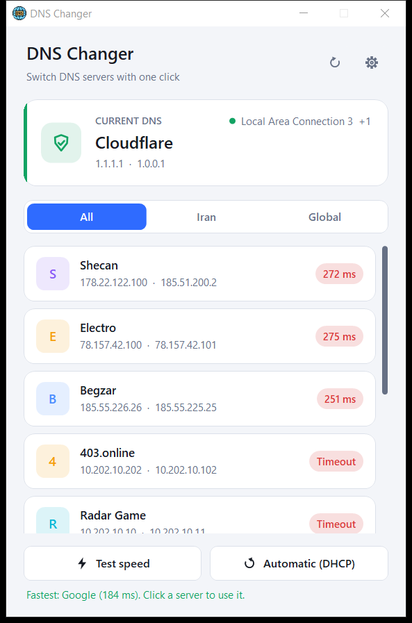
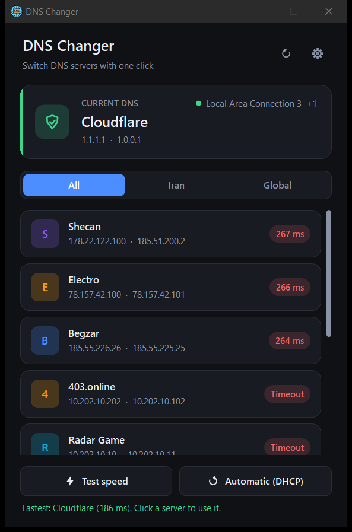
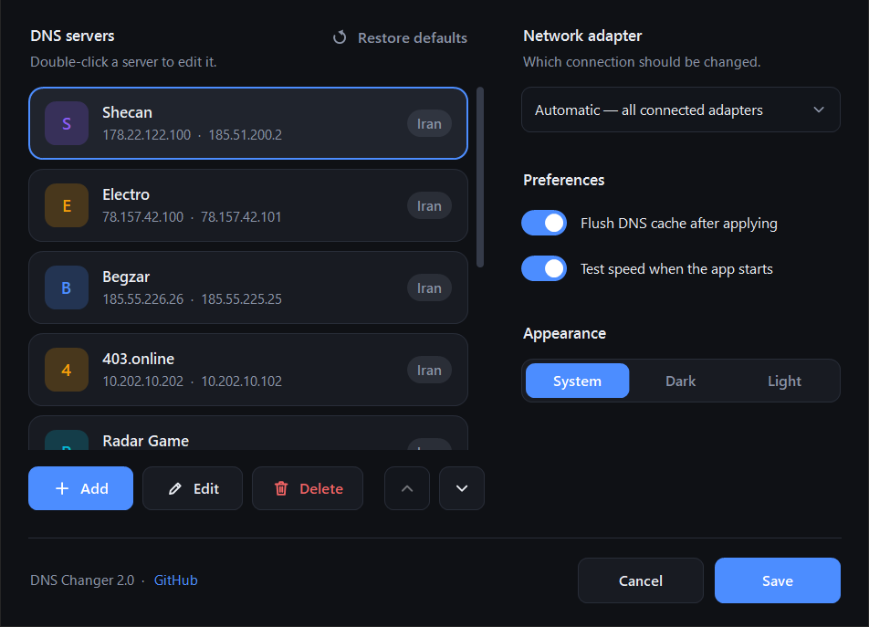

# DNS Changer

**A lightweight Windows app for switching DNS servers with one click.**

A single ~100 KB `.exe`. No installer, no dependencies, nothing running in the background.

<p align="center">
  
  &nbsp;
  
</p>

## Features

- **One-click switching.** Click a server to use it, or go back to **Automatic (DHCP)**.
- **Speed test.** Sends a real DNS query to every server (not just a ping) and shows which one is fastest.
- **Live status.** Shows which DNS your connection is using and updates when the network changes.
- **Editable list.** Add, edit, delete and reorder servers, or restore the defaults at any time.
- **Adapter choice.** Apply to every connected adapter, or only to one you pick.
- **Dark and light themes.** Follows Windows by default and stays sharp on high-DPI screens.
- **Wide compatibility.** Changes DNS through the Windows API, with `netsh` as a fallback, so it works on everything from Windows 7 to 11.

## Built-in DNS servers

| Name | Primary | Secondary | Category |
|---|---|---|---|
| Shecan | 178.22.122.100 | 185.51.200.2 | Iran |
| Electro | 78.157.42.100 | 78.157.42.101 | Iran |
| Begzar | 185.55.226.26 | 185.55.225.25 | Iran |
| 403.online | 10.202.10.202 | 10.202.10.102 | Iran |
| Radar Game | 10.202.10.10 | 10.202.10.11 | Iran |
| Cloudflare | 1.1.1.1 | 1.0.0.1 | Global |
| Google | 8.8.8.8 | 8.8.4.4 | Global |
| Quad9 | 9.9.9.9 | 149.112.112.112 | Global |
| AdGuard (blocks ads) | 94.140.14.14 | 94.140.15.15 | Global |

You can change this list in **Settings**.

<p align="center">
  
</p>

## Download and usage

1. Download `DNS changer.exe` from the [Releases](https://github.com/Phoenix15049/DNSchanger/releases) page.
2. Run it. It asks for administrator rights, because Windows needs them to change DNS settings.
3. Click a server to use it.

| Shortcut | Action |
|---|---|
| `F5` | Refresh the status |
| `Ctrl` + `,` | Open Settings |
| `↑` `↓` `Enter` | Pick a server with the keyboard and apply it |

### Settings file

Settings are saved to `%AppData%\DNSchanger\settings.xml`. Delete that file to restore the defaults.

For **portable mode** (for example, on a USB stick), put a `settings.xml` file next to the exe. If it exists, the app uses it instead.

## Requirements

- Windows 7 SP1, 8, 8.1, 10 or 11
- .NET Framework 4.5 or newer (included in Windows 8 and later)

## Building from source

Build with Visual Studio 2019 or newer, or from the command line:

```bash
msbuild "DNS changer/DNS changer.csproj" -restore -p:Configuration=Release
```

The output is `DNS changer/bin/Release/DNS changer.exe`.

The `Microsoft.NETFramework.ReferenceAssemblies` package is only used at build time, so the .NET 4.5 targeting pack doesn't need to be installed.

### Project layout

```
DNS changer/
├── Core/      DNS changes (WMI / netsh), speed test, settings storage
├── Models/    Data models and the default server list
└── UI/        Main window, settings, editor and custom-drawn controls
```

## Contributing

Pull requests are welcome. For bigger changes, please open an issue first to discuss what you'd like to change.
